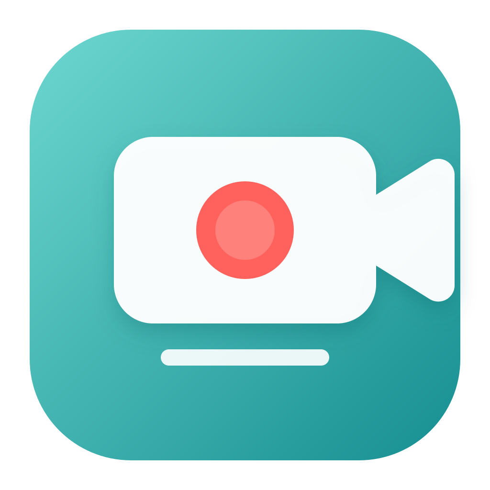

<p align="center"></p>
<h1 align="center">轻录 · QingLu</h1>
<p align="center">把屏幕和讲解清晰地录下来。</p>
<p align="center">macOS 15+ · Apple Silicon · 公开测试版 · CC BY-NC 4.0</p>
<p align="center"><a href="https://github.com/Jin-Hsu/recordmac/releases">下载安装</a> · <a href="README.en.md">English</a> · <a href="docs/FAQ.md">常见问题</a> · <a href="https://github.com/Jin-Hsu/recordmac/issues">反馈问题</a></p>

轻录是一个面向教学演示的原生 macOS 录屏工具。将屏幕、系统声音、麦克风讲解和摄像头画面整合到本地视频，界面简洁，无需账户或虚拟声卡。

## 功能

- 全屏或拖拽框选区域录制，区域边框与录制计时提示。
- 独立开启系统声音、麦克风和摄像头。
- 录制前拖动摄像头布局框、调整大小；停止后合成为画中画。
- 三档画质、30/60 fps 采集选项、倒计时与时长上限。
- 自定义保存文件夹，导出 MP4，本地处理，无水印。

## 下载与安装

1. 打开 [Releases](https://github.com/Jin-Hsu/recordmac/releases)，下载 `QingLu-1.2.1-arm64.dmg`，不要下载仅包含源码的 Source code。
2. 打开 DMG，将「轻录.app」拖入 Applications。
3. 首次打开时，在系统设置 → 隐私与安全性中按需允许屏幕与系统音频录制、麦克风、摄像头，然后退出并重新打开。
4. 建议先录制 10 秒，确认声音、摄像头位置及保存结果。

要求 **Apple Silicon（M 系列）和 macOS 15 或更高版本**。此发行包不适用于 Intel Mac。当前为临时签名、未 Apple 公证的测试版，首次运行可能被 Gatekeeper 拦截；详见 [安装与权限说明](docs/FAQ.md)。

## 当前限制

这是从个人工具整理的首次公开测试版，不保证所有设备组合稳定。正式长录前请先测试。

- 摄像头位置在录制前设置，目前没有录制中拖动真人预览。
- 开启摄像头后的合成输出为 30 fps，即使采集选了 60 fps。
- 摄像头布局缩略图与成片比例仍需完善；音画同步使用启动时间差估算，长录同步尚待验证。
- 多显示器选择、暂停/继续、设备选择与自动更新尚未实现。
- 录制异常时可能遗留临时素材；目前没有自动恢复界面。
- 本次发布验证涵盖构建与包完整性，不等于完成多机型的录制验收。

## 从源码构建

安装 Apple Command Line Tools（或 Xcode），使用 Swift 6 工具链与 macOS 15+ SDK，在仓库根目录运行：

```sh
bash scripts/build.sh
```

输出位于 `dist/`。构建脚本不上传素材、不自动申请系统权限、不安装或覆盖电脑上的应用。

## 参与改进

欢迎在 [Issues](https://github.com/Jin-Hsu/recordmac/issues) 报告故障或提出建议，也欢迎提交小范围 PR。请阅读 [贡献指南](CONTRIBUTING.md)、[隐私说明](PRIVACY.md) 和 [更新日志](CHANGELOG.md)。

## 许可

Copyright © 2026 Jin-Hsu and contributors.

源码、图标和发行文件按 [CC BY-NC 4.0](LICENSE) 授权：允许符合许可条件的非商业分享和修改，须保留署名、提供许可链接并说明修改。商业用途需要另行取得许可。此项目是**源码公开、非商用授权**，并非 OSI 意义上无商业用途限制的开源软件。

项目展示与发布组织参考了 [Mos](https://github.com/Caldis/Mos)；轻录与 Mos 没有关联，也未复制其程序代码或品牌素材。
